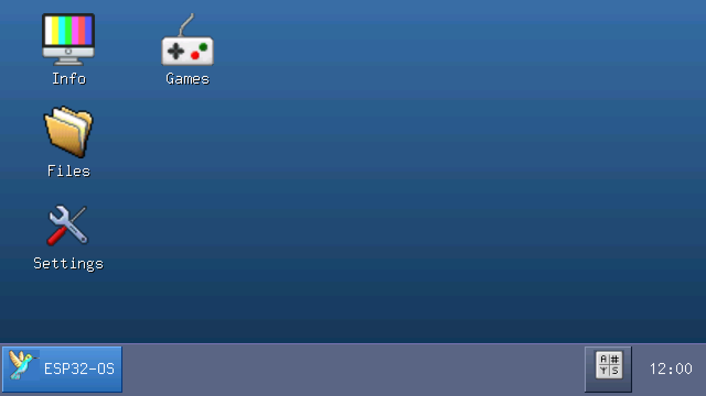
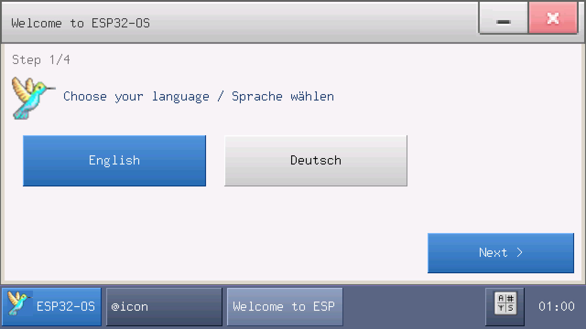
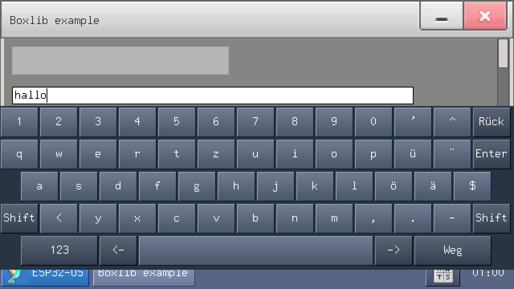
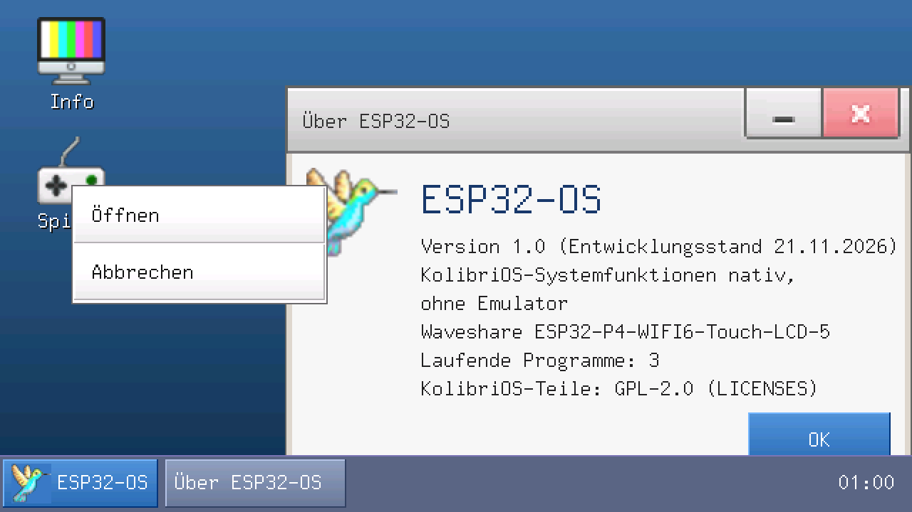

# ESP32-OS

**KolibriOS, running natively on an ESP32-P4 touch console.**

> **Work in progress.** ESP32-OS is an experimental hobby project. Many parts
> work on real hardware, many are still missing (see below). Expect bugs,
> breaking changes and German comments in the code.
>
> This project was **vibecoded with [Claude Code](https://claude.com/claude-code)**:
> the code, tests and documentation were written by an AI assistant under
> human direction and checked on the real board.

ESP32-OS brings the look and the programming interface of
[KolibriOS](https://kolibrios.org) to a microcontroller. There is no x86
emulator: the KolibriOS system functions (windows, drawing, text, buttons,
events, files, threads, memory, sockets, …) are re-implemented natively in
Rust, and original KolibriOS C programs are compiled for the RISC-V CPU and
run unchanged. On top of that sits a touch-friendly desktop with taskbar,
start menu, on-screen keyboard and a set of system programs, a Wi-Fi stack,
the NetSurf web browser and a few games.



## Hardware

**Waveshare ESP32-P4-WIFI6-Touch-LCD-5**
([documentation](https://docs.waveshare.com/ESP32-P4-WIFI6-Touch-LCD-5)):

- ESP32-P4: dual-core RISC-V (360 MHz on chip revision v1.x, 400 MHz on v3.x),
  32 MB PSRAM, 32 MB flash, hardware JPEG decoder and 2D accelerator (PPA)
- ESP32-C6 as Wi-Fi 6 co-processor (connected over SDIO, `esp_hosted`)
- 5" IPS 720×1280 (MIPI-DSI), capacitive touch GT911
- ES8311 audio codec with speaker, microSD slot, LiPo connector

The desktop is drawn at 640×360 logical pixels and scaled ×2 to the panel
(landscape, 1280×720), so every control is large enough for a finger.

## What works today

Everything below has been verified on the board (screenshots and logs in
[`docs/nachweise/`](docs/nachweise/)); details per item are in
[`PLAN.md`](PLAN.md) (German).

**Kernel layer**
- Processes with their own PSRAM heap; a crashing or killed program is
  cleaned up without taking the system down (crash dialog, also after a
  CPU exception).
- KolibriOS system functions implemented natively, original skin
  *Shkvorka*, original system fonts.
- Original KolibriOS C programs (e.g. `basic_gui.c`, box_lib, libimg,
  dialogs) compiled natively; system libraries box_lib, libimg, proc_lib and
  libini as native code.
- Compositor with dirty rectangles (55 FPS while dragging a window).
- File system: internal flash (`/sys` = `/rd/1`) and microSD (`/sd0/1`).
- Two firmware slots with automatic rollback (OTA-ready flash layout).

**Desktop and touch**
- Boots straight into the desktop (icons, taskbar, start menu).
- Tap = click, long press = right click / context menu, swipe = scroll,
  two-finger pinch = zoom, drag the title bar to move, double tap to
  maximise. No hardware buttons needed.
- On-screen keyboard as a system service (Swiss German and US layout),
  copy & paste through the context menu, optional touchpad mode.

**Programs**
- File manager, image viewer (BMP, GIF, PNG, JPEG – baseline JPEG in
  hardware, progressive in software), settings, first-run wizard,
  screenshot tool, task manager (including force-quitting a hung program).
- User interface in English and German.

**Wi-Fi and network**
- Scan and connect by touch, saved networks with automatic reconnect,
  signal strength in the taskbar, time via NTP.
- KolibriOS socket API on top of lwIP (original network samples run).
- Measured throughput 10–25 Mbit/s (TCP/UDP, iperf).

**Browser**
- NetSurf 3.11 (HTML5 parser, CSS 2.1 + parts of CSS 3) with QuickJS-ng as
  JavaScript engine, running as an ESP32-OS program. Local pages render on
  the board; JavaScript (DOM, events, timers, re-layout) runs in the PC
  tests.

**Games** (still started from the older game console, not yet from the
desktop): *Pudding-Panik* (own 3D jump'n'run, 55 FPS), *Würfelwelt*
(voxel world), Doom (doomgeneric) and Quake (quakegeneric). Game data for
Doom and Quake is not included.

| | | |
|---|---|---|
|  |  |  |
|  |  |  |


## What is still missing

- **Browser:** HTTPS and real web pages, address bar, bookmarks, history,
  touch scrolling and zoom, form input with the on-screen keyboard,
  JavaScript on the board, a 20-site compatibility test.
- **Everyday apps:** text editor, calculator, clock with alarm and timer,
  calendar, MP3 player.
- **Games inside the desktop** (full screen, back to the desktop with a
  home button); the old game launcher will be removed.
- **Power:** standby and battery level (needs a voltage divider, see below),
  iTWT power saving, update of the Wi-Fi co-processor firmware.
- **Updates over Wi-Fi:** the code is done (HTTPS with certificate check,
  checksum, OTA into the second slot), the final test needs a GitHub
  release.
- Optimisation, boot-time measurement, a one-hour endurance test, a
  release with a ready-made firmware image and a web flasher.

## Known limitations

- **The Wi-Fi password is stored unencrypted** on the device (NVS in
  flash). Flash encryption is not used and no eFuses are burned – anyone
  with physical access to the board can read saved Wi-Fi credentials.
- Firmware built with the `-Wlan` developer switch contains Wi-Fi test
  credentials. Such builds must never be shared.
- All programs share one address space (no MMU protection between
  programs). A faulty C program can corrupt memory of the system; CPU
  exceptions are caught and reported.
- The battery level cannot be measured without an external voltage divider
  (GPIO21, see `STATUS.md`).
- The ESP32-C6 ships with an old `esp_hosted` firmware: Wi-Fi works, but
  iTWT and co-processor updates over SDIO need a one-time update by cable.
- The browser will handle simple and medium pages; large single-page apps,
  CSS Grid and Web Components are out of reach on 32 MB PSRAM.
- **Binary releases are not cleared yet:** the firmware combines GPL-2.0
  code (NetSurf, KolibriOS parts) with Apache-2.0 code (ESP-IDF,
  esp_hosted). Whether a firmware image may be distributed in this form has
  to be clarified before the first binary release. This does not affect the
  source code in this repository.
- The build currently only works on **Windows** (short fixed paths such as
  `C:\eo`, `C:\ec`, `C:\ns` and a `subst` drive work around Windows path
  limits).

## Building

Requirements (Windows, PowerShell): Git (Git for Windows also provides the
Perl used below), Python 3, [rustup](https://rustup.rs), LLVM
(`winget install LLVM.LLVM`) and

```powershell
cargo install ldproxy espflash --locked
```

The Rust toolchain (a pinned nightly with `rust-src`) is selected
automatically by `esp32/firmware/rust-toolchain.toml`. ESP-IDF v5.5.5 is
downloaded on the first build (1–2 GB, takes a while).

1. **Fetch the browser sources** (NetSurf 3.11, QuickJS-ng 0.18.0, zlib 1.4;
   checked with SHA-256, stored in `C:\ns`):

   ```powershell
   python esp32\netsurf\werkzeuge\quellen_holen.py
   ```

2. **Build** the firmware (ESP32-OS, Doom and Quake programs):

   ```powershell
   powershell -File esp32\firmware\bauen_flashen.ps1 -NurBauen
   ```

   `-Nur esp32os` builds only the operating system. Add `-Release` for a
   firmware that is meant to be shared: it refuses Wi-Fi test credentials
   and checks the finished images for them. The default profile is
   for chip revision v1.x; for v3.x boards change
   `esp_idf_sdkconfig_defaults` in `esp32/firmware/Cargo.toml` to
   `sdkconfig.defaults.rev3_x` and run `cargo clean` once.
   The script reaches the repository through a virtual drive `O:` (short
   paths for ESP-IDF). If `O:` already points to a different folder, it
   stops instead of silently building that folder's code – remove the old
   mapping with `subst O: /D`.

3. **Flash:** connect the board's **USB TO UART** port and run

   ```powershell
   powershell -File esp32\firmware\bauen_flashen.ps1 -Port COM3
   ```

   (use your COM port; `-Monitor 60` records 60 s of serial log).

4. **Optional game data:** `python esp32\doom\wad\holen.py` and
   `python esp32\quake\pak\holen.py` download the shareware files for local
   use. Quake reads `ESP32-OS\quake\pak0.pak` from the microSD card; Doom
   reads `DOOM1.WAD` from the internal data partition.

### Tests on the PC

The kernel, the KolibriOS layer, the desktop and the browser have PC tests
with reference images (in `esp32`):

```powershell
cargo test --profile sim -q -p kern
cargo test --profile sim -q -p kolibri --target i686-pc-windows-msvc
cargo test --profile sim -q -p desktop
cargo test --profile sim -q -p netsurf
```

## Repository layout

| Path | Content |
|---|---|
| `esp32/kern` | kernel layer: processes, heaps, windows, KolibriOS system functions |
| `esp32/kolibri` | KolibriOS C programs, native system libraries, image decoders |
| `esp32/desktop` | shell (desktop, taskbar, start menu, keyboard) and system programs |
| `esp32/netsurf` | NetSurf/QuickJS port |
| `esp32/firmware` | ESP-IDF firmware (drivers, Wi-Fi, flash layout, build script) |
| `esp32/game`, `esp32/wuerfelwelt`, `esp32/doom`, `esp32/quake`, `esp32/konsole` | games and the old game console |
| `esp32/gehaeuse` | 3D-printable case (OpenSCAD) |
| `spatz`, `pudding`, `mcu_demo` | the software 3D engine *spatz*, the PC version of Pudding-Panik and a bare-metal Cortex-M7 demo |
| `docs/nachweise` | screenshots and logs taken on the board |

## License

ESP32-OS as a whole – in particular everything under `esp32/` and the
firmware built from it – is licensed under the **GNU General Public License
v2.0** – see [`LICENSE`](LICENSE). It contains code and data from KolibriOS
(GPL-2.0), doomgeneric and quakegeneric (GPL-2.0-or-later) and builds on
NetSurf (GPL-2.0-only), its MIT-licensed libraries, QuickJS-ng (MIT) and
zlib.

Exception: the stand-alone crates of the root Cargo workspace, **`spatz`**
(software 3D engine) and **`pudding`** (PC version of the game), are
licensed under **MIT OR Apache-2.0**, as declared in their `Cargo.toml`
(license texts: `spatz/LICENSE-MIT`, `spatz/LICENSE-APACHE`,
`pudding/LICENSE-MIT`, `pudding/LICENSE-APACHE`).
When they are built into the ESP32-OS firmware, the firmware as a whole is
GPL-2.0.

Details: [`THIRD_PARTY_NOTICES.md`](THIRD_PARTY_NOTICES.md).

Doom and Quake game data are not included.
