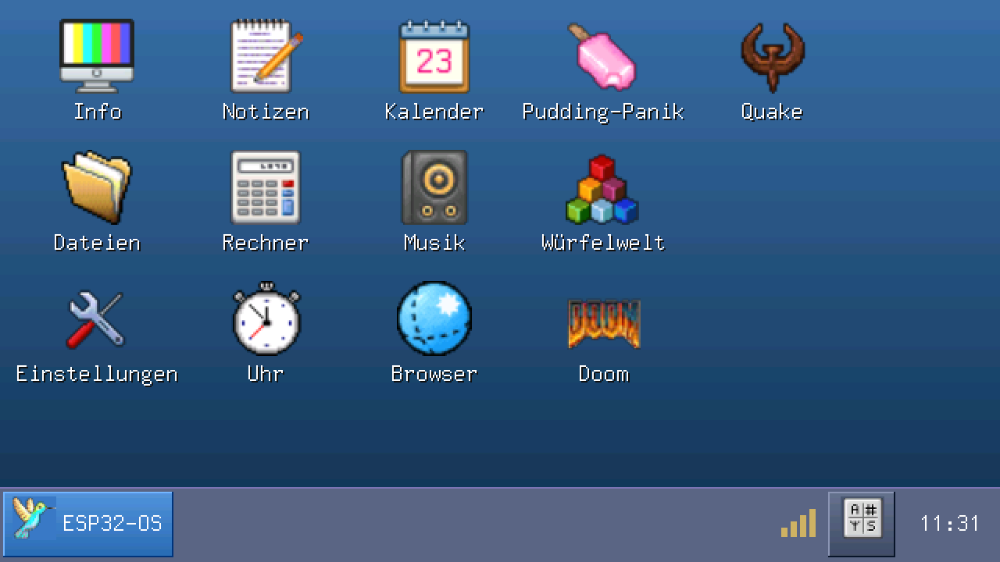
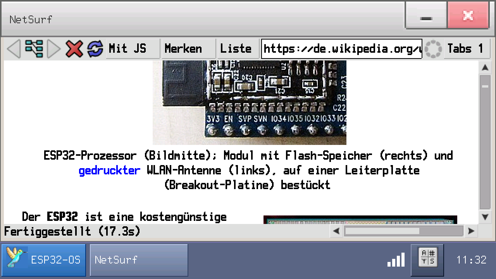
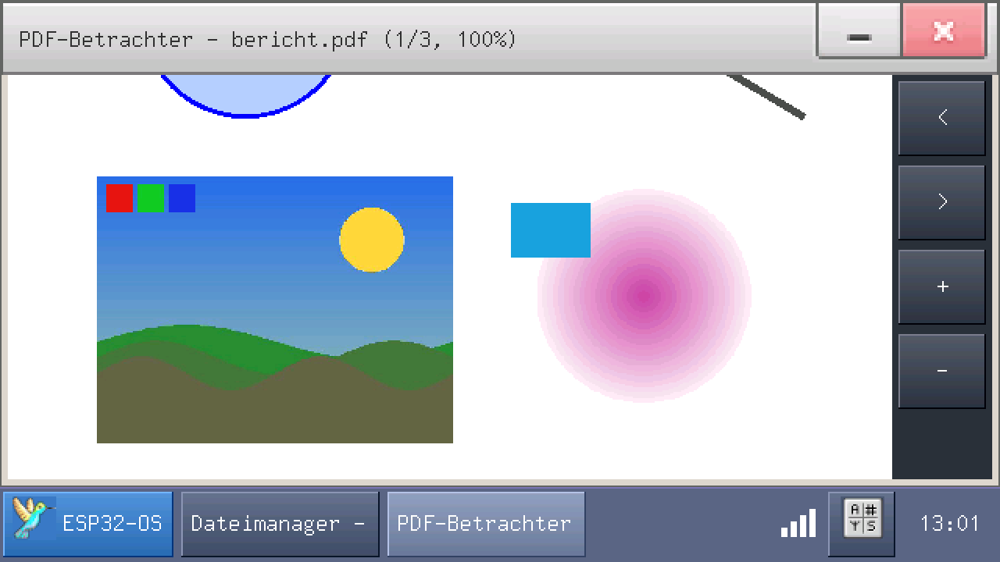
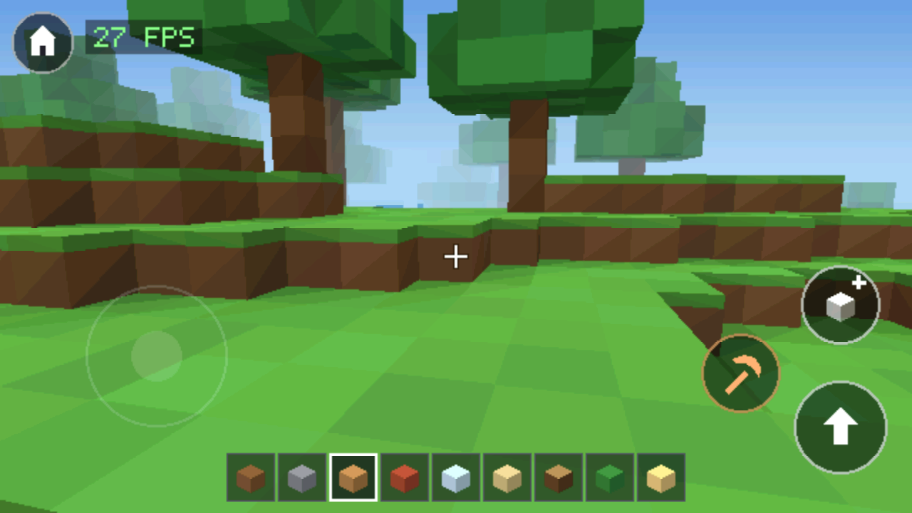

# ESP32-OS

A KolibriOS-compatible OS running natively on an ESP32-P4 touch console.

<!-- Photo of the board in the hand: docs/images/board.jpg (to be added) -->

| | |
|---|---|
|  |  |
|  |  |

ESP32-OS re-implements the KolibriOS system functions in Rust instead of emulating x86. Original KolibriOS C programs are compiled for the RISC-V CPU and run unchanged. On top of that run a touch desktop, system programs, the NetSurf web browser and four games.

## Facts

Measured on the board (Waveshare ESP32-P4-WIFI6-Touch-LCD-5, chip revision v1.x, 360 MHz):

| | Value | Evidence |
|---|---|---|
| OS image | 5.4 MiB (5,687,168 bytes), 91 % of its 5.9 MiB flash slot | [o8_release_paket.txt](docs/nachweise/o8/o8_release_paket.txt) |
| Power-on to desktop | 3.5 s | [o4_1_apps_log.txt](docs/nachweise/o4/o4_1_apps_log.txt) |
| Browser scrolling | 32 frames/s (Wikipedia article) | [o1_scroll_log.txt](docs/nachweise/o1/o1_scroll_log.txt) |
| PDF page (A4 with photo, text, shapes) | 0.24 s | [z1_board_log.txt](docs/nachweise/z1/z1_board_log.txt) |
| Games | Pudding-Panik 55, Doom 55, Würfelwelt 27.6, Quake 27.5 frames/s | [o4/](docs/nachweise/o4/) |
| Wi-Fi throughput (TCP) | 11.6 Mbit/s to the board, 9.8 Mbit/s from the board | [w8_durchsatz.txt](docs/nachweise/w8_durchsatz.txt) |
| Endurance | 1 h with browser and Wi-Fi, no reset | [o5_auswertung.txt](docs/nachweise/o5/o5_auswertung.txt) |

## Quick start

1. Download the files of the latest release from the Releases page, or open the web flasher (`docs/flasher/`, Chrome or Edge) and skip to step 4.
2. Connect the board's USB TO UART port.
3. Flash with [espflash](https://github.com/esp-rs/espflash):
   ```
   espflash write-bin 0x2000   bootloader.bin
   espflash write-bin 0x8000   partition-table.bin
   espflash write-bin 0x10000  otadata-leer.bin
   espflash write-bin 0x20000  esp32os.bin
   espflash write-bin 0xC00000 doomapp.bin
   espflash write-bin 0xE00000 quakeapp.bin
   ```
4. Optional: copy the shareware files `DOOM1.WAD` to `ESP32-OS/doom/` and `pak0.pak` to `ESP32-OS/quake/` on the microSD card.

No binary release has been published yet. Until then, build from source as described below.

## Features

| Area | What works |
|---|---|
| Kernel | KolibriOS system functions in Rust, one heap per program, crash isolation with error dialog, compositor with dirty rectangles, two firmware slots with automatic rollback |
| KolibriOS programs | Original C programs, unchanged: PasswordGen, TinyHashView and the clayer samples; native box_lib, libimg, proc_lib, libini, network |
| Desktop | Icons, taskbar with Wi-Fi signal and clock, start menu, tap, long press, swipe and pinch, on-screen keyboard (Swiss German, US), English and German interface, first-run wizard |
| Programs | File manager (microSD and internal flash), image viewer (JPEG in hardware, PNG, GIF, BMP), PDF viewer, settings, notes, calculator, clock with alarm and timer, calendar, MP3 player, task manager, screenshot tool |
| Wi-Fi 6 | Via the ESP32-C6: scan and connect by touch, remembered networks, time via NTP |
| Browser | NetSurf 3.11, HTTPS with certificate check, tabs, bookmarks, history, downloads, zoom, forms, JavaScript (QuickJS-ng: DOM, events, timers, fetch, cookies, localStorage) |
| Games | Pudding-Panik, Würfelwelt, Doom, Quake, started from the desktop |
| Updates | Firmware update over Wi-Fi from GitHub releases with SHA-256 check and rollback (not yet tested end to end, needs the first release) |

## Limitations

- Wi-Fi passwords are stored unencrypted in flash (no flash encryption, no eFuses).
- The browser has 10 MB of memory. Large web applications do not load; some web APIs are missing.
- The PDF viewer shows text in the system font, opens files up to 4 MB and does not decode CCITT, JBIG2 or JPEG 2000 images.
- The image viewer opens images up to about 0.85 megapixels.
- All programs share one address space. A faulty program is stopped and reported, but can still disturb the system.
- No standby, no battery gauge, no camera support yet (planned for 1.1).
- Release images combine GPL-2.0 code (NetSurf, KolibriOS) with Apache-2.0 code (ESP-IDF). Whether they may be distributed in this form is being clarified; the source code is not affected.
- The build runs on Windows only.

Full list with reasons: `docs/development/PLAN.md`, section "Abweichungen" (German).

## Hardware

Waveshare ESP32-P4-WIFI6-Touch-LCD-5 ([documentation](https://docs.waveshare.com/ESP32-P4-WIFI6-Touch-LCD-5)):

- ESP32-P4, dual-core RISC-V (360 MHz on chip revision v1.x, 400 MHz on v3.x), 32 MB PSRAM, 32 MB flash, hardware JPEG decoder, 2D accelerator (PPA)
- ESP32-C6 as Wi-Fi 6 co-processor (SDIO, esp_hosted)
- 5" IPS panel 720×1280 (MIPI-DSI), capacitive touch (GT911)
- ES8311 audio codec with speaker, microSD slot, LiPo connector

The desktop is drawn at 640×360 and scaled ×2 to the panel in landscape. A 3D-printable case is in [`esp32/gehaeuse/`](esp32/gehaeuse/).

## Building

Requirements (Windows, PowerShell): Git, Python 3, [rustup](https://rustup.rs), LLVM (`winget install LLVM.LLVM`) and `cargo install ldproxy espflash --locked`. The Rust toolchain is pinned in `esp32/firmware/rust-toolchain.toml`. ESP-IDF 5.5 is downloaded on the first build (1 to 2 GB).

1. Fetch the browser sources (NetSurf, QuickJS-ng, zlib; SHA-256 checked, stored in `C:\ns`):
   ```powershell
   python esp32\netsurf\werkzeuge\quellen_holen.py
   ```
2. Build all images:
   ```powershell
   powershell -File esp32\firmware\bauen_flashen.ps1 -NurBauen
   ```
   The default profile is for chip revision v1.x. For v3.x set `esp_idf_sdkconfig_defaults` in `esp32/firmware/Cargo.toml` to `sdkconfig.defaults.rev3_x` and run `cargo clean` once. The script maps the repository to drive `O:` for short paths.
3. Flash (use your COM port):
   ```powershell
   powershell -File esp32\firmware\bauen_flashen.ps1 -Port COM3
   ```
4. Optional game data for local use: `python esp32\doom\wad\holen.py` and `python esp32\quake\pak\holen.py`.

PC tests (Git Bash): `bash esp32/werkzeuge/alle_tests.sh`. A release package is built with `esp32\firmware\release_paket.ps1 -Version 1.0`.

## Repository layout

| Path | Content |
|---|---|
| [`esp32/`](esp32/) | ESP32-OS source: kernel, KolibriOS layer, desktop, browser, games, firmware |
| [`spatz/`](spatz/) | software 3D engine used by the games |
| [`docs/`](docs/) | images, web flasher, release notes, evidence, development documents |
| [`LICENSES/`](LICENSES/) | license texts of all third-party components |

## License

ESP32-OS is licensed under the GNU General Public License v2.0 ([`LICENSE`](LICENSE)). The `spatz` crate is MIT OR Apache-2.0; built into the firmware it is part of the GPL-2.0 work. Third-party components and their licenses are listed in [`THIRD_PARTY_NOTICES.md`](THIRD_PARTY_NOTICES.md). Doom and Quake game data are not included.

## Credits

- [KolibriOS](https://kolibrios.org): system function interface, C programs, libraries, skin, fonts and icons
- [NetSurf](https://www.netsurf-browser.org): web browser
- [QuickJS-ng](https://github.com/quickjs-ng/quickjs): JavaScript engine
- [doomgeneric](https://github.com/ozkl/doomgeneric): Doom port
- [quakegeneric](https://github.com/erysdren/quakegeneric): Quake port

ESP32-OS was developed with Claude Code.

Follow the progress on TikTok: @The_Unknown_Coder
