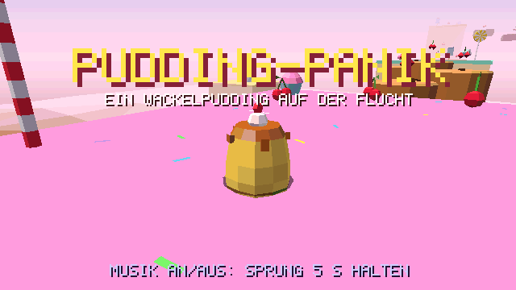
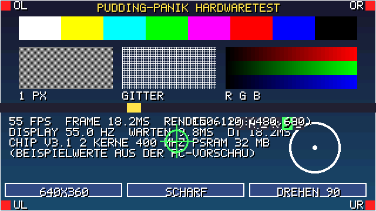

# Pudding-Panik für den ESP32-P4

Eigene Fassung des Spiels für das **Waveshare ESP32-P4-WIFI6-Touch-LCD-5**
([Doku](https://docs.waveshare.com/ESP32-P4-WIFI6-Touch-LCD-5)): ESP32-P4
(RISC-V, 2 Kerne, 400 MHz bei Chip-Revision v3.x, FPU), 32 MB PSRAM, 32 MB
Flash, 768 KB interner RAM; 5″-IPS 720×1280 hochkant (HX8394, MIPI-DSI
2 Lanes), Touch GT911, Audio-Codec ES8311 mit Lautsprecher, LiPo-Anschluss.

Spiel und Firmware sind in Rust geschrieben (gerechnet wird mit `f32`). Die
Hardware-Treiber für Display (MIPI-DSI), Bildbeschleuniger (PPA), Touch, I²S,
I²C, ADC und Flash kommen aus **ESP-IDF**, eingebunden über `esp-idf-svc`
(enthält `esp-idf-sys` und `esp-idf-hal`) – so, wie Waveshare es für den P4
empfiehlt.

**Bedienung: nur Touch.** Knöpfe an der 40-Pin-Leiste sind vorbereitet, aber
standardmäßig aus.

> Bauen und Flashen von ESP32-OS: [`../README.md`](../README.md); Stand und
> offene Punkte: [`../STATUS.md`](../STATUS.md) und [`../PLAN.md`](../PLAN.md).



*(Aufnahme aus der PC-Simulation in 640×360.)*

---

## Checkliste: sobald das Board da ist

1. **Werkzeuge installieren** (einmalig, Windows/PowerShell; Git und
   Python 3 müssen da sein):

   ```bash
   rustup toolchain install nightly --component rust-src
   ```

   ```bash
   cargo install ldproxy espflash --locked
   ```

   ```bash
   winget install --id LLVM.LLVM
   ```

2. **Board anschließen:** Lautsprecher stecken, USB-C an **USB TO UART**
   (nicht USB OTG). Akku vorerst weglassen. Knöpfe braucht es nicht.
3. **Testprogramm bauen und flashen** (im Ordner `esp32/firmware`):

   ```bash
   cargo run --release --bin hwtest
   ```

   Der erste Build lädt ESP-IDF v5.5.5 und drei Treiber herunter (~1–2 GB)
   und dauert lange. Bricht er mit „path too long“ ab:
   `$env:CARGO_TARGET_DIR = "C:\pt"` setzen und nochmal.
4. **Chip-Revision prüfen:** Die erste Zeile im seriellen Monitor (und
   espflash beim Flashen) zeigt sie. **v3.x** → alles passt.
   **v1.x** → Profil umstellen (siehe „Bauen“), `cargo clean`, nochmal flashen.
5. **Bild prüfen:** weißer Rand rundherum, rote Ecken richtig beschriftet
   (OL oben links …), Kreis rund, gelber Balken läuft ohne Ruckeln.
   Steht alles auf dem Kopf: Tippfeld „DREHEN“.
6. **Scharf prüfen:** Das Feld „1 PX“ muss bei „SCHARF“ ein feines
   Schachbrett zeigen (bei „WEICH“ grau). Ist es auch bei „SCHARF“ grau, kopiert
   der PPA bei Faktor 1 nicht exakt – dann bitte melden.
7. **Touch prüfen:** Der grüne Ring muss genau unter dem Finger sitzen; mit
   zwei Fingern zwei Ringe. Unten rechts im Text: Abfragen pro Sekunde (~250)
   und „GPIO2“ – wechselt das beim Berühren, ist der Touch-Interrupt
   angeschlossen (siehe „Offene Punkte“).
8. **Messung abwarten** (~12 s nach dem Start): Im seriellen Monitor erscheint
   die Tabelle mit Rendern, Skalieren, PPA-Ausgabe und Arbeitszeit je
   Betriebsart.
9. **BOOT-Knopf:** drücken und auf „GPIO35“ achten (Bildschirm und Monitor).
   Springt es auf LOW → melden, dann wird er Pause/Zurück.
10. **Spiel flashen:** `cargo run --release`. Oben links stehen FPS, RENDER,
    SKALIER und FRAME. **FRAME** ist die Arbeitszeit pro Bild ohne Warten auf
    VSync; bleibt sie unter ~18 ms, läuft das Spiel mit vollen 55 FPS. Unter
    Optionen → Vergrößern scharf und weich vergleichen (der serielle Monitor
    zeigt alle 2 s die Werte). Unter Optionen → Touch-Steuerung Größe,
    Deckkraft, Joystick und Hand einstellen.
11. **Später:** Knöpfe und Akkuanzeige anlöten (siehe unten).

Den Monitor beendet man mit Strg+C; `espflash monitor` öffnet ihn erneut.

## Das Hardware-Testprogramm

```bash
cargo run --release --bin hwtest
```



Es zeigt ein Testbild in 640×360, gerendert in Streifen auf beiden Kernen,
per PPA vergrößert und gedreht – genau der Weg, den auch das Spiel nimmt.

**Messung beim Start:** Je ~3 s läuft jede Betriebsart (640×360 scharf/weich,
320×180 scharf/weich). Danach steht im seriellen Monitor eine Tabelle:

| Spalte | Bedeutung |
|---|---|
| Rendern | Streifen zeichnen (hier: das Testbild; im Spiel kommt die 3D-Szene dazu) |
| Skalieren | scharfes Vergrößern durch die CPU (0 bei „weich“) – **das kostet „scharf“** |
| PPA-Ausgabe | PPA beauftragen und auf ihn warten |
| Arbeit (max) | ganze Arbeitszeit pro Bild ohne VSync-Warten, Mittel und Spitzenwert |
| Budget | OK, wenn die Arbeit unter ~18,2 ms bleibt (55 Hz) |

Auf dem Bild:

| Element | prüft |
|---|---|
| weißer 1-Pixel-Rand, rote Ecken „OL/OR/UL/UR“ | nichts abgeschnitten, Bild richtig herum |
| Feld „1 PX“ (Schachbrett aus Einzelpixeln) | scharf: klare Karos; weich: graue Fläche |
| Gitter, Farbbalken, R/G/B-Verläufe | Farben, Byte-Reihenfolge, Abstufung |
| Kreis | Seitenverhältnis (muss rund sein) |
| laufender gelber Balken | gleichmäßiger Bildwechsel, kein Zerreißen |
| grüner Ring unter dem Finger | Touch trifft die richtige Stelle |
| Kästchen V H L R S B | Knöpfe (nur mit `BUTTONS_ENABLED`) und B = GPIO 35 |
| drei Tippfelder unten | Auflösung · Vergrößerung · Drehung umschalten |

Wie das Testbild im hochkant liegenden Panel ankommt:
[`docs/testbild/testbild_panel_720x1280.png`](docs/testbild/testbild_panel_720x1280.png).

## Was drin ist

* **Das ganze Spiel** inkl. Wackelpudding-Weichkörper, zwei Level,
  Hauptmenü, Spielstand im Flash (NVS), Rekorde. Die Demo (Autopilot nach
  25 s im Titelbild) ist abgeschaltet – `DEMO_ENABLED` in `game/src/app.rs`.
* **Komplett per Touch bedienbar:**
  * **Steuerknüppel** auf der einen Bildhälfte – schwebend (entsteht dort, wo
    der Daumen aufsetzt) oder fest.
  * **Sprungknopf** auf der anderen Hälfte: Trefferfläche ist die ganze
    Hälfte, der halbtransparente Kreis nur die Markierung.
  * **Pause** oben links; alle Menüs per Antippen, Werte durch Antippen am
    linken/rechten Rand.
  * **Feedback** statt Tastengefühl: Knüppel ploppt auf und leuchtet, der
    Sprungknopf füllt sich und zeigt einen Ring, angetippte Menüzeilen
    leuchten kurz auf.
  * **Optionen → Touch-Steuerung:** Größe (klein/mittel/groß), Deckkraft
    (5 Stufen), Joystick fest/schwebend, Rechts-/Linkshänder – mit Vorschau.
  * Die Steuerelemente bleiben über der Tippzeile und unter dem HUD (geprüft
    für alle Einstellungen), Zahlen und Meldungen bleiben lesbar.
  * Touch wird in einem eigenen Thread ~250-mal pro Sekunde abgefragt; ein
    kurzes Antippen zwischen zwei Bildern geht nicht verloren.
* **Querformat, 16:9:** 640×360 (Standard) oder 320×180 („Performance“).
* **Vergrößern ×2 bzw. ×4** (nur ganzzahlig) und **Drehen um 90°** auf
  720×1280: **scharf** (Nearest-Neighbor, Standard) oder **weich** (bilinear).
* **Beide Kerne rendern** (Streifen abwechselnd), Ausgabe mit **VSync**.
* **Gleichmäßig bei 55 Hz:** Physik fest bei 120 Schritten pro Sekunde;
  angezeigt wird zwischen zwei Schritten interpoliert (auch zeitgesteuerte
  Animationen). Die Spielzeit rückt pro Bild um genau die Zahl der
  Bildwechsel des Panels vor.
* **FPS-Anzeige oben links:** FPS, Renderzeit, Zeit fürs scharfe Vergrößern,
  Arbeitszeit pro Bild.
* **Audio:** eigener Synthesizer auf Kern 1, zwei Musikstücke, 21 Effekte;
  **Sprung 5 s halten** = Musik an/aus (auch per Touch).
* **Akkuanzeige** im Hauptmenü („AKKU 87%“) und im Spiel (Batterie oben
  links neben dem Pause-Knopf, gelb unter 35 %, rot unter 15 %, blinkt unter
  10 %) – optional, siehe unten.

## 40-Pin-Leiste: was wo hängt

Laut Pin-Tabelle der [Waveshare-Doku](https://docs.waveshare.com/ESP32-P4-WIFI6-Touch-LCD-5).
Die Leiste ist **nicht** wie beim Raspberry Pi belegt (Pin 1 = 5 V,
Pin 2 = 3V3), und die Tabelle sagt nicht, wo Pin 1 sitzt – **vor dem Löten
am Platinenaufdruck prüfen**.

| Leisten-Pin | Signal | benutzt für |
|---|---|---|
| 13 | GND | Akkuanzeige |
| 15 | GPIO21 | Akkuanzeige (ADC1 Kanal 5) |
| 30 | GPIO35 | BOOT? (nur Anzeige in `hwtest`) |
| 32 | GPIO49 | Knopf Vorne |
| 33 | GND | Knöpfe |
| 34 | GPIO50 | Knopf Hinten |
| 36 | GPIO51 | Knopf Links |
| 38 | GPIO52 | Knopf Rechts |
| 39 | GPIO48 | Knopf Springen |
| 40 | GND | Knöpfe |

## Knöpfe (optional, standardmäßig aus)

Fünf Taster auf **GPIO 48, 49, 50, 51, 52** (Pins siehe Tabelle), jeweils
zwischen Pin und GND; die internen Pull-ups sind aktiv. Einschalten in
[`firmware/src/board.rs`](firmware/src/board.rs): `BUTTONS_ENABLED = true`.
Dann blendet die Touch-Steuerung sich beim ersten Knopfdruck aus und beim
nächsten Antippen wieder ein.

Gemieden: 34–38 (Boot-Strapping des ESP32-P4), 24/25 (USB), 2 (möglicherweise
Touch-Interrupt), 7/8 (I²C), 21 (Akkuanzeige).

**BOOT-Knopf:** Die Waveshare-Unterlagen nennen seinen GPIO nicht, daher ist
er **nicht** belegt (Pause per Touch oben links). `hwtest` zeigt den Pegel
von GPIO 35. Springt er beim Drücken von BOOT auf LOW, in `board.rs`
`BTN_MENU` auf `Some(35)` setzen.

## Akkuanzeige (optional, standardmäßig aus)

Die Platine lädt den Akku selbst, misst seine Spannung aber nicht an einem
GPIO. Mit zwei Widerständen geht es:

```text
Akku + ──[ R1 200 kΩ ]──┬── Leisten-Pin 15 (GPIO 21)
                        │
                   [ R2 100 kΩ ]   ║ C 100 nF (parallel zu R2)
                        │
GND (Leisten-Pin 13) ───┴──────────
```

* **Pin:** GPIO 21 = Leisten-Pin 15, GND = Leisten-Pin 13 (beides aus der
  Waveshare-Tabelle). GPIO 21 ist ADC1 Kanal 5 (ESP-IDF,
  `soc/esp32p4/include/soc/adc_channel.h`). Weitere ADC-fähige Pins der Leiste:
  GPIO 22 (ADC1) und GPIO 49–52 (ADC2, aber für die Knöpfe vorgesehen).
* **Widerstände:** R1 = 200 kΩ, R2 = 100 kΩ (1 %), Teiler 1:3. Bei vollem Akku
  (4,2 V) liegen 1,4 V am Pin – weit unter dem Messbereich und der
  3,3-V-Grenze, auch wenn R2 einmal abreißt. Der Teiler zieht dauerhaft
  ~14 µA, bei 3000 mAh vernachlässigbar.
* **Kondensator:** 100 nF keramisch von Pin 15 nach GND.
* **Akku +** am Pluskontakt des MX1.25-Akkuanschlusses abgreifen (Polarität
  vorher mit dem Multimeter prüfen). Den Schaltplan konnte ich nicht
  auslesen: Prüf kurz, dass an Leisten-Pin 15 nichts anderes hängt (laut
  Tabelle ist er frei).
* **Einschalten:** in `board.rs` `BATTERY` auf `Some(BATTERY_SUGGESTED)`
  setzen. `hwtest` zeigt dann die Spannung; mit einem Multimeter vergleichen
  und `divider` (3,0) bei Bedarf anpassen: 3,0 × Multimeter ÷ Anzeige.
* **Anzeige:** Prozent nach einer üblichen LiPo-Entladekurve (Näherung, unter
  Last etwas zu niedrig). Beim Laden über USB zeigt sie mehr an. Ohne Akku
  oder bei unplausiblen Werten erscheint nichts.

## Steuerung

| Eingabe | im Spiel | im Menü |
|---|---|---|
| Touch, Knüppel-Hälfte | laufen (relativ zur Kamera) | – |
| Touch, Sprung-Hälfte | springen (kurz = kleiner Hüpfer) | – |
| Sprung 5 s halten | Musik an/aus | – |
| Touch oben links | Pause | – |
| Menüzeile antippen | – | auswählen / umschalten |
| Am linken/rechten Rand tippen | – | Wert kleiner / größer |
| *mit Knöpfen:* Richtungen / Springen / Links+Rechts | laufen / springen / Pause | auswählen / bestätigen |

Knüppel-Hälfte ist links (Rechtshänder) bzw. rechts (Linkshänder).

## Bauen

Im Ordner `esp32/firmware`: `cargo run --release --bin hwtest` (Test),
`cargo run --release` (Spiel). Werkzeuge: siehe Checkliste.

* **Chip-Revision:** Wie die Waveshare-Beispiele baut das Projekt für
  **v3.x** (400 MHz, PSRAM 250 MHz). Für **v1.x** (360 MHz, PSRAM 200 MHz)
  vor dem Bauen setzen und einmal `cargo clean`:

  ```bash
  $env:ESP_IDF_SDKCONFIG_DEFAULTS = "sdkconfig.defaults;sdkconfig.defaults.rev1_3"
  ```

## Darstellung: wie ein Bild entsteht

1. Das Bild (640×360 oder 320×180) wird in **Streifen** geteilt (16 Zeilen bei
   640, 32 bei 320). Kern 0 rendert die geraden, Kern 1 gleichzeitig die
   ungeraden.
2. Farbe und Tiefe eines Streifens liegen im **internen RAM** (je 20 KB pro
   Kern; Farbe doppelt). Der Tiefenpuffer verlässt den internen RAM nie; im
   PSRAM liegen nur die drei Bildspeicher des Displays und die Spieldaten.
   Passt etwas nicht in den internen RAM, landet es im PSRAM; `hwtest` zeigt,
   wo.
3. Jeder fertige Streifen geht sofort an den **PPA**, der ihn gedreht an die
   richtige Stelle des Bildspeichers schreibt, während der Kern schon den
   nächsten rendert:
   * **scharf:** Die CPU vervielfacht die Pixel ×2 bzw. ×4 in einen Block im
     internen RAM (40 KB), der PPA dreht ihn nur (Faktor 1). Grund: Laut
     Espressif-Doku skaliert der PPA **ausschließlich bilinear**. Was das
     kostet, misst `hwtest` (Spalte „Skalieren“).
   * **weich:** Der PPA vergrößert (bilinear) und dreht direkt, ohne CPU-Last.
4. Sind alle Streifen im Bildspeicher, wird mit dem nächsten Bildanfang
   umgeschaltet (**VSync**, drei Bildspeicher im Wechsel, kein Zerreißen).

Am PC geprüft: Dieser Weg ergibt bitgenau dasselbe Panelbild wie das ganze
Bild in einem Stück, für beide Auflösungen, Drehungen und Vergrößerungsarten.

## Offene Punkte (nicht gesichert, `hwtest` klärt sie)

Kurz:

* **Scharf oder weich als Standard:** Entscheidung nach der Messung. Sprengt
  „scharf“ bei 640×360 im Spiel das Budget von ~18 ms, wird „weich“ Standard.
* **PPA bei Faktor 1 exakt?** naheliegend, aber nicht dokumentiert (Feld „1 PX“).
* **Bildwiederholrate:** rechnerisch 55,0 Hz; `hwtest` misst die echte.
* **BOOT-Knopf:** GPIO nicht dokumentiert (GPIO 35 prüfen).
* **Touch-Interrupt:** laut Waveshare an GPIO 2 nur über einen optionalen
  Widerstand – bis zur Bestätigung wird abgefragt (250-mal pro Sekunde).
* **400 MHz:** Kconfig-Name `CONFIG_ESP_DEFAULT_CPU_FREQ_MHZ_400` unbestätigt;
  `hwtest` zeigt den echten Takt.
* **Die Firmware wurde noch nie für den P4 gebaut** (nur am PC gegen
  nachgebaute Schnittstellen typgeprüft) – kleine Anpassungen an den
  C-Schnittstellen beim ersten Build sind wahrscheinlich.

## Am PC testen (ohne Hardware)

Im Ordner `esp32`:

| Befehl | Zweck |
|---|---|
| `cargo test --profile sim` | 34 Tests: Level schaffbar, Menüs und Spiel **nur per Touch**, Linkshänder, Touch-Steuerung überdeckt kein HUD, Optionen, Speichern, Musik-Schalter, gleichmäßige Bewegung bei 55 Hz, Bildtakt, Renderer, Streifen + Blöcke + Drehung = Vollbild, Touch-Umrechnung, Testbild, Akku-Kurve, Synth, Spielstand |
| `cargo run --profile sim -p pudding-sim -- testbild ORDNER` | Testbild quer und so, wie es im Panel steht |
| `cargo run --profile sim -p pudding-sim -- shots ORDNER` | PNG-Bilder aller Bildschirme |
| `cargo run --profile sim -p pudding-sim -- gif vorschau.gif 30` | Spielszene als GIF |
| `cargo run --profile sim -p pudding-sim -- wav ORDNER` | Musik und Effekte als WAV |
| `cargo run --profile sim -p pudding-sim -- mem` | Speicherbedarf |
| `cargo run --profile sim -p pudding-sim -- bench` | Frame-Zeit am PC |

## Aufbau

```text
esp32/
  game/       Spielkern (no_std, f32): app, play, render, gfx, hud, input,
              touchpad (Touch-Steuerung), present (Streifen, Blöcke, Drehung,
              Bildtakt), testbild, battery, audio, save
  sim/        PC-Simulation (Tests, Bilder, GIF, WAV, Speicher, Benchmark)
  firmware/   ESP32-P4-Firmware
    src/board.rs      alle Pins und Schalter (Knöpfe, Akku, Touch-Interrupt)
    src/lib.rs        Display (DSI), Ausgabe (Streifen + PPA, 2 Kerne,
                      Zeitmessung), Touch (GT911, eigener Thread), Audio
                      (I²S → ES8311), Akku (ADC), Knöpfe, NVS
    src/bin/hwtest.rs Hardware-Testprogramm mit Messung
    src/main.rs       das Spiel
  docs/       Vorschau, Bilder, Testbild, Hörproben
```
