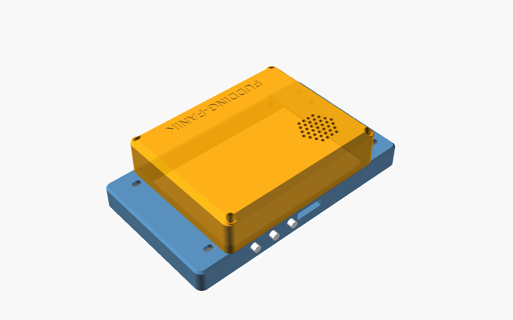
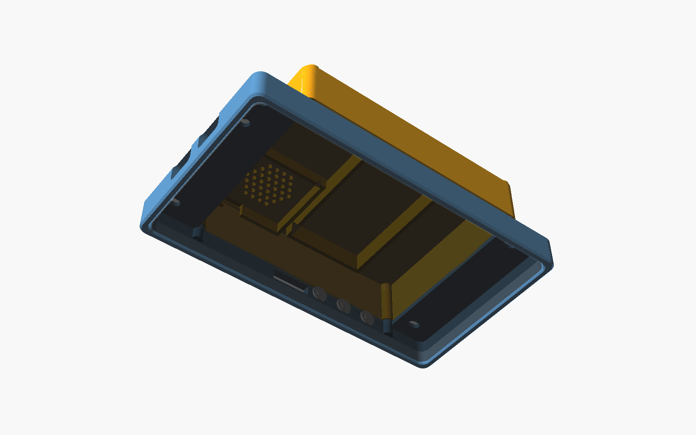

# gehaeuse (case)

3D-printable case for the Waveshare ESP32-P4-WIFI6-Touch-LCD-5, designed in OpenSCAD (`gehaeuse.scad`). The display glass sits flush; a bump at the back holds battery and speaker, with thin grips left and right.




## Parts

| File | Part | Size | Note |
|---|---|---|---|
| `stl/testrahmen.stl` | test frame | 133.5 × 77.3 × 4.5 mm | print first (~30 min) to check the glass fit |
| `stl/schale.stl` | frame and grips | 133.5 × 77.3 × 13.5 mm | back side down |
| `stl/buckel.stl` | back bump (battery, speaker) | 97.2 × 77.3 × 21.5 mm | back side down |
| `stl/taster.stl` | 3 button plungers | Ø 6.5 × 7.7 mm each | shaft down |

All parts are oriented for printing and need no supports.


Print settings: PLA or PETG, 0.2 mm layers, 3 walls, 15–20 % infill. A brim helps against warped corners on the frame. Fits a 220 × 220 mm bed.

## Screws and parts

- 4 × M2.5 × 6 for the board (into its four standoffs). Check one screw first; if the standoffs are M3, use M3 × 6 (the slots fit both).
- 4 × M2 × 10 self-tapping screws to fix the bump to the frame.
- Double-sided tape or foam for battery and speaker.

## Assembly

1. Put the test frame on the glass. It should drop in with little play. If it is too tight or too loose, change `GLAS_SPIEL` in `gehaeuse.scad` (default 0.3 mm per side) and export again.
2. Insert the 3 plungers from the inside (collar inside) and hold them with tape from the outside.
3. Insert the display from the front, board first, until the four standoffs rest at the back. Fix it with the 4 M2.5 screws through the slots. Remove the tape.
4. Glue the speaker into the small frame in the bump (opening towards the grille) and the battery into the large one (cable down left).
5. Connect the battery to BAT and the speaker to SPK. The speaker cable is short, so hold the bump close to the frame.
6. Put the bump on and fix it with the 4 M2 screws from the back.

To change the battery, remove only the 4 bump screws. Both USB-C ports (left), RESET/BOOT/POWER and the microSD slot (top) and the power LED (light hole back left) stay accessible.

## Dimensions

All dimensions are parameters at the top of `gehaeuse.scad`.

| Dimension | Value | Source |
|---|---|---|
| glass | 126.90 × 70.70 mm | Waveshare drawing |
| board, holes | 118.5 × 64.5 mm, grid 112 × 57 mm | Waveshare drawing |
| board position on the glass | 1.72 mm from the left, centred vertically | measured from the drawing |
| USB, buttons, microSD | positions | Waveshare drawing |
| `Z_HUELSE` = 11 mm | glass front to end of standoffs | estimated from photos |
| `AKKU` = 29 × 49 × 19 mm | battery | measured |
| `LS` = 26 × 26 × 6 mm | speaker | estimated |

`Z_HUELSE` is worth measuring: too small and the glass stands out slightly, too large and it sits slightly deeper (both fit). Total thickness: 13.5 mm at the grips, 35 mm at the bump.

Export with OpenSCAD (manifold backend):

```text
openscad --backend=manifold -D TEIL="schale_druck" -o stl/schale.stl gehaeuse.scad
openscad --backend=manifold -D TEIL="buckel_druck" -o stl/buckel.stl gehaeuse.scad
openscad --backend=manifold -D TEIL="taster_druck" -o stl/taster.stl gehaeuse.scad
openscad --backend=manifold -D TEIL="testrahmen" -o stl/testrahmen.stl gehaeuse.scad
```

Check: `TEIL="pruefung"` intersects all parts with a model of display, board (components, pin header, USB, buttons, microSD), battery and speaker. The result must be empty ("Current top level object is empty"); only frame and bump touch at their contact surface.
