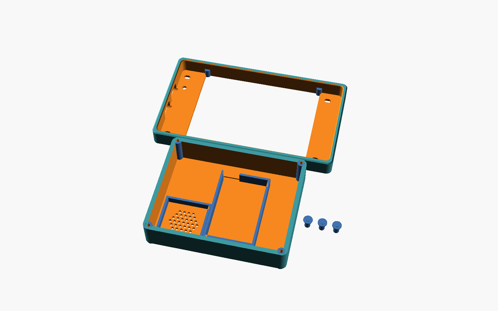

# Gehäuse für die Pudding-Panik-Konsole

3D-Druck-Gehäuse für das **Waveshare ESP32-P4-WIFI6-Touch-LCD-5**: Das
Display sitzt passgenau, alles andere hat großzügig Luft. Hinten in der Mitte
ein Buckel mit Akku und Lautsprecher, links und rechts dünne Griffe.


## Teile

| Datei | Teil | Maße | Hinweis |
|---|---|---|---|
| `stl/testrahmen.stl` | Probe-Rahmen | 133,5 × 77,3 × 4,5 mm | **zuerst** drucken (~30 min): passt das Glas? |
| `stl/schale.stl` | Rahmen + Griffe | 133,5 × 77,3 × 13,5 mm | Rückseite unten |
| `stl/buckel.stl` | Mittelteil (Akku, Lautsprecher) | 97,2 × 77,3 × 21,5 mm | Rückseite unten |
| `stl/taster.stl` | 3 Tastenstößel | je Ø 6,5 × 7,7 mm | Schaft unten |

Alle Teile liegen schon richtig herum und brauchen **keine Stützen**.



**Druckeinstellungen (Cura):** PLA oder PETG, 0,2 mm Schichthöhe, 3 Wände,
15–20 % Füllung, keine Stützen. Für die Schale hilft ein Brim (Rand) gegen
hochgebogene Ecken. Passt auf ein 220 × 220-mm-Bett.

## Schrauben und Kleinteile

* **4 × M2,5 × 6** – Platine (in ihre vier Abstandshülsen). Vorher mit einer
  Schraube prüfen, ob die Hülsen M2,5 haben; bei M3 einfach M3 × 6 nehmen –
  die Langlöcher passen für beide.
* **4 × M2 × 10, selbstschneidend** (Blechschraube/Kunststoffschraube) –
  Buckel an die Schale. Normale M2-Schrauben schneiden sich auch ins 1,7-mm-Loch.
* Doppelseitiges Klebeband oder ein Stück Schaumstoff für Akku und Lautsprecher.

## Zusammenbau

1. **Probe-Rahmen** aufs Glas legen: Es sollte mit wenig Spiel hineinfallen.
   Zu eng/zu weit → `GLAS_SPIEL` in `gehaeuse.scad` ändern (Standard 0,3 mm
   je Seite) und neu ausgeben.
2. Die 3 **Taster** von innen in die Löcher der oberen Wand stecken (Kragen
   innen) und außen mit einem Streifen Klebeband halten.
3. Das **Display** mit der Platine voran von vorne in die Schale setzen, bis
   die vier Abstandshülsen hinten aufliegen. Von hinten die 4 Schrauben M2,5
   durch die Langlöcher eindrehen. Klebeband von den Tastern abziehen.
4. **Lautsprecher** in den kleinen Rahmen im Buckel kleben (Öffnung zum
   Gitter), **Akku** in den großen (Kabel nach unten links).
5. Akku in die Buchse **BAT**, Lautsprecher in **SPK** stecken. Das
   Lautsprecherkabel ist kurz – den Buckel dafür dicht an die Schale halten.
6. **Buckel** aufsetzen, 4 Schrauben M2 von hinten durch die tiefen Löcher.

Zum Akku-Tauschen nur die 4 Buckel-Schrauben lösen; das Display bleibt drin.

Zugänglich bleiben: beide USB-C-Buchsen (links), RESET/BOOT/POWER und die
SD-Karte (oben), die PWR-LED (Lichtloch hinten links).

## Maße anpassen

Alles steht oben in `gehaeuse.scad` als Parameter. Herkunft der Maße:

| Maß | Wert | Quelle |
|---|---|---|
| Glas | 126,90 × 70,70 mm | Maßzeichnung Waveshare |
| Platine, Bohrungen | 118,5 × 64,5 mm, Raster 112 × 57 mm | Maßzeichnung Waveshare |
| Lage der Platine auf dem Glas | links 1,72 mm, mittig in der Höhe | aus der Zeichnung gemessen |
| USB, Tasten, SD | Positionen aus der Zeichnung | Maßzeichnung Waveshare |
| `Z_HUELSE` = 11 mm | Glasvorderseite bis Ende der Hülsen | **aus Fotos geschätzt** |
| `AKKU` = 29 × 49 × 19 mm | Breite × Länge × Dicke | gemessen |
| `LS` = 26 × 26 × 6 mm | Lautsprecher | **geschätzt** |

Lohnt sich nachzumessen: **`Z_HUELSE`** – ist der Wert zu klein, steht das
Glas etwas vor, ist er zu groß, liegt es etwas tiefer (passen tut es beides).

Gesamtdicke: 13,5 mm an den Griffen, 35 mm am Buckel.

**Neu ausgeben** (OpenSCAD, z. B. die portable Version unter
`C:\pt\openscad\OpenSCAD-2026.11.16-x86-64\`):

```text
openscad --backend=manifold -D TEIL="schale_druck" -o stl/schale.stl gehaeuse.scad
openscad --backend=manifold -D TEIL="buckel_druck" -o stl/buckel.stl gehaeuse.scad
openscad --backend=manifold -D TEIL="taster_druck" -o stl/taster.stl gehaeuse.scad
openscad --backend=manifold -D TEIL="testrahmen" -o stl/testrahmen.stl gehaeuse.scad
```

**Kontrolle:** `TEIL="pruefung"` schneidet alle Teile mit einer Nachbildung
von Display, Platine (Bauteile, Stiftleiste, USB, Tasten, SD), Akku und
Lautsprecher. Ergebnis muss leer sein („Current top level object is empty“) –
nur Schale und Buckel berühren sich in ihrer Auflagefläche.
